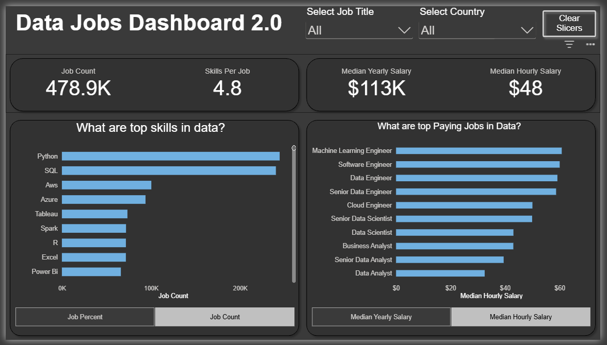

# Data Jobs Dashboard v2 w/ Power BI

🔗 [View Interactive Dashboard](https://app.powerbi.com/view?r=eyJrIjoiOWFjZGY4NWYtZmQ3ZC00ZTFkLWE4MjEtM2RhNjZlNmQ2ODEyIiwidCI6IjY5ODEzOTE4LWEzNDgtNDI0Zi04MTY4LTRiMjQ2ZTg2MjQ1YyJ9)

## Introduction

Exploring the data job market can be challenging, especially with so much information spread across different platforms. This dashboard (V2.0) is designed to help **job seekers, career changers, and professionals exploring opportunities in data** better understand the job market.

Using real-world job posting data from 2024, the dashboard brings together information on **job titles, salaries, locations, and market trends** in one interactive page, making it easier to compare opportunities and make informed career decisions.

### 🛠️ Skills and Tools Used

- 🎨 **Dashboard Design:** Designed a clean, user-friendly layout to make data exploration simple and engaging.
- ⚙️ **Power Query (ETL):** Cleaned, transformed, and prepared raw datasets for analysis.
- 🔗 **Data Modeling:** Established relationships between tables using Star Schema principles to improve data organization and analysis.
- 🧮 **DAX Calculations:** Developed measures and calculated columns to analyze data and extract meaningful insights.

- 📊 **Data Visualization:**
  - 📈 **Charts:** Used bar, column, line, and area charts to compare data and identify trends.
  - 🗺️ **Maps:** Visualized job opportunities across different geographic locations.
  - 🔢 **KPI Cards:** Highlighted important metrics for quick insights.
  - 📋 **Tables:** Presented detailed information in an organized and accessible format.
  - 🎨 **Visual Selection:** Chose appropriate chart types to communicate data clearly.

- 🎛️ **Interactive Dashboard Features:**
  - 🔍 **Slicers:** Allowed users to filter data dynamically based on their preferences.
  - 🔘 **Buttons & Bookmarks:** Created an interactive experience with simplified navigation between report views.
  - ➡️ **Drill-Through:** Enabled users to explore more detailed information on specific job categories.

## Dashboard Overviewx

This updated version brings together the most important job market insights into **one interactive dashboard**, allowing job seekers to explore relevant information quickly and easily without navigating through multiple pages.

This dashboard provides a quick overview of the data job market through key metrics such as **Job Count, Skills Per Job, Median Yearly Salary, and Median Hourly Salary**.

It also highlights the **most in-demand skills**, allowing users to switch between job counts and percentages, while comparing **salary levels across different data-related job titles** to better understand market demand and earning potential.

### Conclusion

The second version of my Power BI dashboard (V2.0) demonstrates how large datasets can be transformed into a practical and interactive tool for exploring the data job market.

By bringing together essential information on **job opportunities, salaries, and in-demand skills** into a single page, the dashboard helps **job seekers, career changers, and data professionals** identify trends, compare career options, and make more informed decisions about their next steps.

