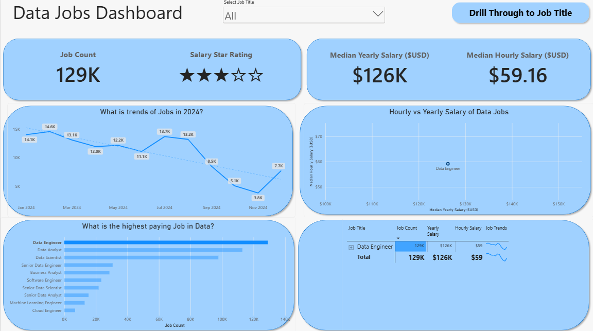
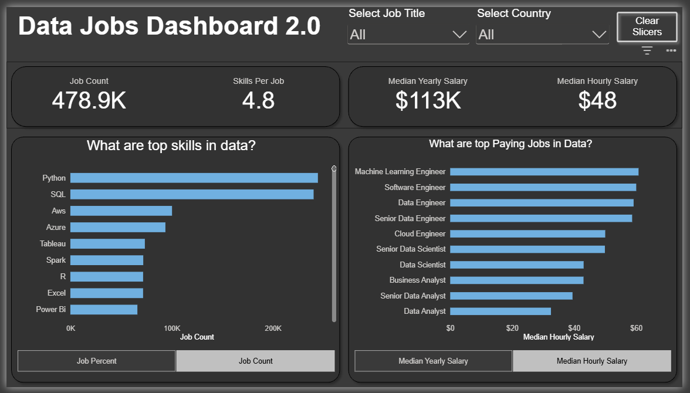

# 📊 My Power BI Dashboard Portfolio

Welcome to my Power BI portfolio! This repository showcases a collection of interactive dashboards I've developed as I continue building my skills in data analytics and business intelligence.

Each project focuses on transforming raw data into meaningful visualizations, uncovering trends, and presenting insights that support data-driven decision-making.

## 📊 Featured Dashboards

Below are the Power BI dashboards I've created throughout my learning journey. Each project includes its own README, where I explain the development process, key features, and insights gained from the analysis.

### 📊 Data Jobs Dashboard (V1 - Job Market Analysis)

🌐 **[Explore the Interactive Dashboard on Power BI](https://app.powerbi.com/view?r=eyJrIjoiM2I3YThjMjYtZmM1Zi00ZTU5LTg1NGMtN2MyNzhiOTA4ZjU5IiwidCI6IjY5ODEzOTE4LWEzNDgtNDI0Zi04MTY4LTRiMjQ2ZTg2MjQ1YyJ9)**

**🛠️ Power BI Skills Applied:**
- 🎨 Dashboard Design & Visual Layout
- ⚙️ Data Cleaning and Transformation using Power Query
- 🔗 Data Modeling and Table Relationships
- 🧮 DAX Measures and Calculated Columns
- 📊 Data Visualization (Bar Charts, Line Charts, Maps, etc.)
- 🔢 KPI Cards and Performance Metrics
- 🎛️ Interactive Slicers and Dynamic Filtering
- 🔄 Field Parameters for Switching Between Measures
- 🧭 Buttons, Bookmarks, and Page Navigation
- ➡️ Drill-Through for Detailed Data Exploration

➡️ **[Explore Project 1: Full Details & Documentation](Data_Jobs_v1/README.md)**

## 📊 Data Jobs Dashboard V2.0 — Interactive Job Market Overview

🌐 **[Explore the Interactive Dashboard on Power BI](https://app.powerbi.com/view?r=eyJrIjoiOWFjZGY4NWYtZmQ3ZC00ZTFkLWE4MjEtM2RhNjZlNmQ2ODEyIiwidCI6IjY5ODEzOTE4LWEzNDgtNDI0Zi04MTY4LTRiMjQ2ZTg2MjQ1YyJ9)**

### 🛠️ Power BI Skills Developed in Version 2.0

This version builds on my previous dashboard, incorporating more advanced Power BI techniques to improve interactivity, usability, and overall performance.

- 🎨 **Dashboard Design:** Created a more organized, single-page layout with improved user experience and visual consistency.
- ⚙️ **Power Query:** Applied advanced data cleaning and transformation techniques to prepare datasets for analysis.
- 🔗 **Data Modeling:** Used Star Schema principles to establish efficient relationships between tables.
- 🧮 **Advanced DAX:** Developed measures using functions such as `CALCULATE`, `ALL`, and `ALLSELECTED` to manage filter context and perform dynamic calculations.
- 📊 **Dynamic Visualizations:** Built interactive charts that update based on user selections.
- 🎛️ **Field Parameters:** Enabled users to switch between different measures, such as Job Count and Job Percent.
- 🎚️ **Numeric Parameters:** Implemented adjustable parameters for interactive what-if analysis.
- 🗺️ **Geospatial Analysis:** Used map visualizations to explore job opportunities across different locations.
- 🔢 **KPI Cards:** Presented essential metrics in a clear and accessible format.
- 🔍 **Interactive Filtering:** Improved data exploration through slicers and cross-filtering between visuals.
- ⚡ **Performance Optimization:** Applied techniques to improve report organization, efficiency, and responsiveness.

➡️ **[Explore Project 2: Full Details & Documentation](Data_Jobs_v2/README.md)**

---

## 📁 About This Portfolio

Each dashboard featured in this portfolio has a dedicated `README.md` file within its project folder. These files provide a more detailed explanation of the project's purpose, datasets, development process, and Power BI features implemented.

They also highlight the techniques I've learned and applied throughout each project, offering a closer look at how the dashboards were developed and how the data was transformed into meaningful insights.
